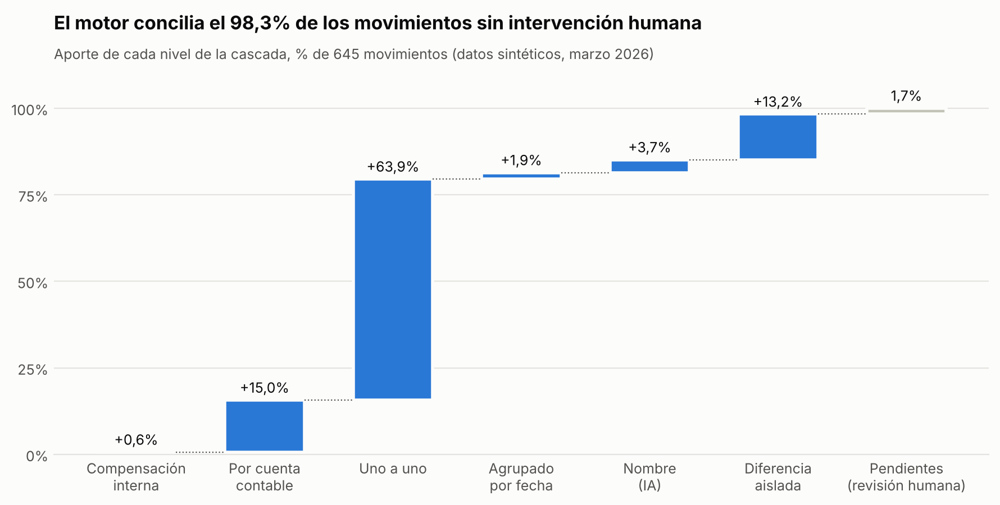
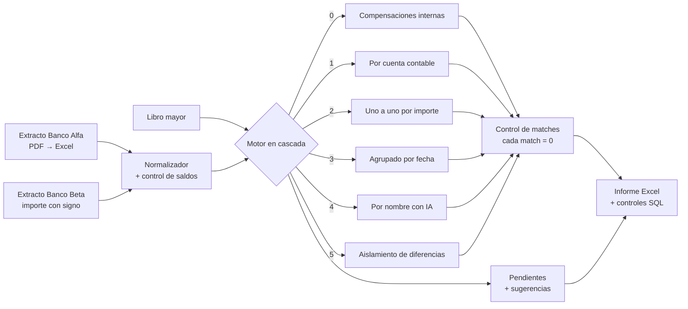

# Conciliación bancaria automatizada con IA

Motor que concilia extractos bancarios contra el libro mayor contable. Resuelve en minutos el trabajo que suele llevar días y deja **solo las excepciones** para revisión humana, cada una con una sugerencia de qué pasó.



> **Recreación con datos sintéticos** de una solución que desarrollé e implementé para un estudio contable y su cartera de clientes. En producción concilia automáticamente **entre el 90 y el 95% de los movimientos de un mes en 10 a 15 minutos**. El código, los nombres y los importes de este repositorio son ficticios; la lógica es la misma.

---

## El problema

Conciliar a mano un banco contra la contabilidad es lento y propenso a errores:

- Cada banco exporta distinto y, cuando el extracto viene de un PDF, llega desordenado.
- Un mismo movimiento se escribe de una forma en el banco (`TRANSF RECIBIDA PEREYRA MARTIN ALEJANDRO CUIT 20-…`) y de otra en el mayor (`Cobro FC A 0001-00001234 Pereyra`).
- Hay cientos de filas chicas (comisiones, IVA, impuestos) que en el mayor se registran en un solo asiento mensual.
- Lo importante, los errores reales, queda escondido entre cientos de movimientos que están bien.

## La solución



**1. Normalización.** Cada formato de banco se lleva a un esquema único (`fecha, concepto, ingreso, egreso, saldo`). Se verifica fila por fila que `saldo anterior + ingreso − egreso = saldo`, para garantizar que no se perdió ni se duplicó ningún movimiento al leer el PDF.

**2. Conciliación en cascada**, de lo más seguro a lo más arriesgado:

| Nivel | Qué hace | Ejemplo |
|---|---|---|
| 0 · Compensación interna | Un contra-asiento o un reverso bancario se compensa con su original **dentro del mismo origen**, si la corrección se hizo en el mes. Si no, la diferencia queda a la vista | Pago cargado dos veces y anulado; débito directo rechazado y revertido por el banco |
| 1 · Por cuenta contable | Si el total de una cuenta cierra entre banco y mayor (ingresos y egresos **siempre por separado**, para que un error no compense a otro), se concilia entera | 22 acreditaciones QR contra 1 asiento mensual |
| 2 · Uno a uno | Un movimiento contra un asiento del mismo importe, **solo si el match es único** | Pago a un proveedor |
| 3 · Agrupado por fecha | Varias filas de un lado contra una del otro, dentro de ±1 día | 5 transferencias de sueldos contra 1 asiento de haberes |
| 4 · Por nombre (IA) | Extrae el nombre de la contraparte del texto libre (Gemini) y concilia por totales de cada cliente o proveedor | Dos clientes que pagaron el mismo importe; una factura pagada en dos transferencias |
| 5 · Aislamiento de diferencias | Si una cuenta no cierra por 1 o 2 movimientos exactos, concilia el resto y deja esos a la vista | Una comisión que quedó fuera del asiento mensual de gastos |

**3. Control de matches.** Cada match tiene que cerrar en cero:

```
(Banco Debe − Banco Haber) − (Contabilidad Debe − Contabilidad Haber) = 0
```

El informe incluye una hoja con una fila por match y sus cuatro columnas (Debe y Haber de banco y de contabilidad). Las compensaciones internas cierran dentro de un mismo origen: su Debe se cancela con su Haber. Si algún match no da cero, la fila se marca en rojo y la conciliación no se da por buena. Es la red de seguridad del propio motor: en las pruebas, alterar un solo importe en $1.000 hace saltar la alerta en ese match.

**4. Revisión guiada.** Lo que ningún nivel resuelve queda pendiente, con una hipótesis:

| Pendiente | Sugerencia del motor |
|---|---|
| Cobro de $1.250.000 en banco y $1.205.000 en el mayor | *Posible error de importe con Quiroga: diferencia $45.000* |
| Dos asientos iguales del mismo cobro | *Posible asiento duplicado. Revisar y anular el sobrante* |
| Pago con cheque registrado y no debitado | *Posible cheque en tránsito. Verificar en el extracto siguiente* |
| Transferencia sin datos del ordenante | *Ingreso sin identificar. Pedir el comprobante al banco* |

El criterio de diseño es **no forzar nunca un match dudoso**: un pendiente de más se revisa en un minuto; un error escondido puede costar meses.

## Resultados (datos sintéticos)

El generador siembra **7 excepciones reales** y **2 errores ya corregidos en el mes** (ingresos sin registrar, cheque en tránsito, error de tipeo, asiento duplicado, etc.) y guarda la respuesta correcta de cada movimiento. Así el motor se mide de forma objetiva:

| Métrica | Resultado |
|---|---|
| Movimientos procesados (2 bancos + mayor) | 645 |
| Conciliados automáticamente | **98,3%** |
| Precisión (lo conciliado estaba bien) | **100%**, 0 falsos positivos |
| Excepciones sembradas detectadas | **7 de 7** |
| Errores corregidos en el mes que concilió (duplicado anulado, débito revertido) | **2 de 2** |
| Matches que cierran en cero | **224 de 224** |
| Tiempo de ejecución | ~3 segundos |

En datos reales la tasa automática es menor (90–95%) porque los textos son más desordenados. Por eso la precisión, no la tasa, es la métrica que se protege.

## Cómo correrlo

```bash
git clone https://github.com/ClaudioCGG/conciliacion-bancaria-ia.git
cd conciliacion-bancaria-ia
pip install -r requirements.txt

python scripts/generar_datos.py      # genera el mes de ejemplo
python conciliar.py                  # concilia y deja el informe en ejemplos/
python scripts/controles_sql.py      # controles de gestión en SQL (DuckDB)
python -m pytest                     # 19 tests, incluida la medición contra la verdad
```

O abrí [`notebooks/demo_conciliacion.ipynb`](notebooks/demo_conciliacion.ipynb) directo en Google Colab.

**Con IA:** definí `GEMINI_API_KEY` (y opcionalmente `GEMINI_MODEL`) y la etapa de nombres usa Gemini. Sin la clave, usa un extractor por reglas para que cualquiera pueda correr la demo sin costo.

## El informe

`ejemplos/conciliacion_202603.xlsx` trae:

- **Resumen:** movimientos, % automático y aporte de cada nivel por banco.
- **Pendientes:** solo lo que requiere acción, con tipo y sugerencia.
- **Control de matches:** cada match con su Debe y Haber por origen; la diferencia tiene que dar cero.
- **Por cuenta contable:** totales banco vs. mayor y diferencias.
- **Detalle por banco:** cada movimiento con su nivel, número de match y días de diferencia; lo conciliado en gris, para que lo pendiente salte a la vista.

## Controles de gestión en SQL

[`sql/controles.sql`](sql/controles.sql) agrega controles sobre el resultado: aporte acumulado de cada nivel (funciones de ventana), asientos cargados con más de 10 días de demora, demora promedio de carga por usuario y pendientes ordenados por impacto en pesos.

## Estructura

```
src/conciliacion/
  normalizador.py       extractos de cada banco -> esquema único + control de saldos
  categorias.py         concepto -> cuenta contable (reglas editables)
  motor.py              conciliación en cascada (niveles 0 a 5)
  extractor_nombres.py  nombre de la contraparte: Gemini o reglas + unificación difusa
  revision.py           pendientes con sugerencias + control de matches
  reporte.py            informe Excel con formato
  metricas.py           precisión, cobertura y detección de excepciones
scripts/                generador de datos sintéticos y controles SQL
sql/                    consultas de control
tests/                  pytest
```

## Stack

Python · Pandas · Gemini API · RapidFuzz · DuckDB (SQL) · OpenPyXL · Matplotlib · pytest · Google Colab

---

**Claudio Gabriel Guirado** · Analista BI y automatización de procesos con IA para administración y finanzas
[GitHub](https://github.com/ClaudioCGG)
